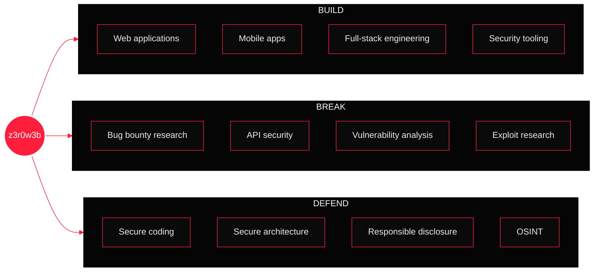
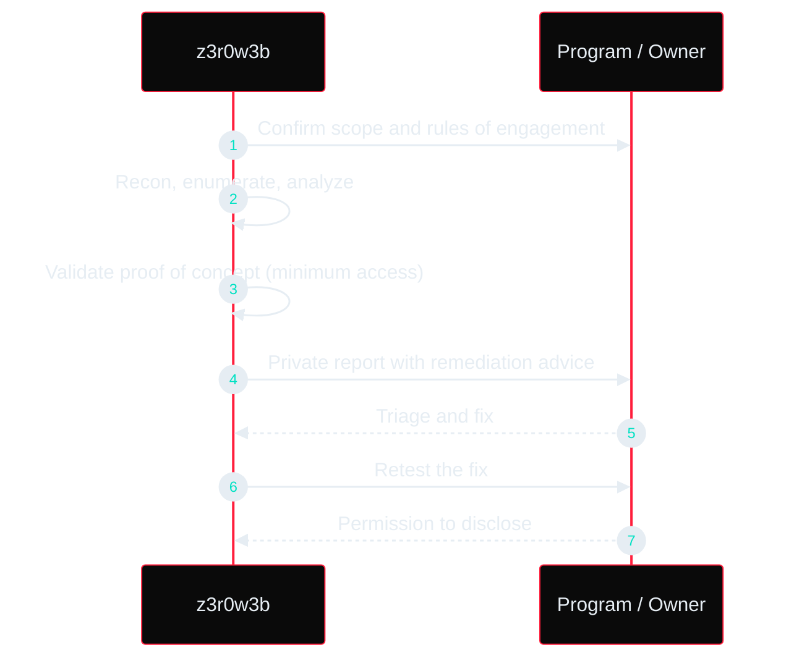

<!--
  Hello, friend.
  If you are reading the source, CHALLENGE 3301 is for you.
  SGVsbG8sIGZyaWVuZC4gVGhlIGRvb3IgaXMgb3Blbi4gLS0gejNyMHczYg==
-->

<div align="center">


<a href="https://github.com/z3r0byt3s3c"></a>

<br/>


<br/><br/>

<a href="#-01--dossier">DOSSIER</a> ·
<a href="#-03--arsenal">ARSENAL</a> ·
<a href="#-04--operations">OPERATIONS</a> ·
<a href="#-06--challenge-3301">CHALLENGE 3301</a> ·
<a href="#-08--open-channels">CONTACT</a>

</div>

<br/>

```text
       _____      ____          _____ __
 ____ |__  /_____/ __ \_      _|__  // /_
/_  /  /_ </ ___/ / / / | /| / //_ </ __ \
 / /____/ / /  / /_/ /| |/ |/ /__/ / /_/ /
/___/____/_/   \____/ |__/|__/____/_.___/

 [ SECURE CHANNEL // ENCRYPTED // 3301 ]
```

> [!IMPORTANT]
> **Authorized targets only. Responsible disclosure. Always.**
> I only test what I have permission to test, I prove impact with the minimum access needed, and I report privately first.

<br/>


## 🔴 01 // DOSSIER

I am a developer and security enthusiast focused on building reliable applications, exploring vulnerabilities, and creating technology that is **secure by design**.

I work across web development, mobile development, and cybersecurity, combining engineering with security research to understand how systems are built, tested, and protected.

> *It has become easy to build but hard to break, and that is where the real work is.*

```bash
z3r0w3b@nairobi
─────────────────────────────────────────────────────────────
Handle ........ z3r0w3b  (kevinw3b · z3r0byt3 · z3r0lords3c)
Base .......... Nairobi, Kenya
Class ......... Penetration Tester · Bug Bounty Hunter · Full-Stack Dev
Cert .......... CEH (Certified Ethical Hacker)
Ventures ...... bytebugtech · CardRex · ProFinder
Community ..... AfricaHackon private security research group
Platform ...... HackerOne → z3r0lords3c
Motto ......... Develop. Test. Secure. Repeat.
```

<!--
  PROOF OF WORK — fill in with real HackerOne numbers, then move this block out of the comment:

  ## PROOF OF WORK
  | HackerOne | |
  |:--|:--|
  | Reputation | ___ |
  | Rank | ___ |
  | Signal / Impact | ___ / ___ |
  | Valid reports | ___ |
  | Public acknowledgements | ___ |
-->

<br/>


## 🔴 02 // ATTACK SURFACE



**Training queue**

```text
ADVANCED WEB SECURITY         [███████████████░░░░░]  75%
APPLICATION SECURITY          [██████████████░░░░░░]  70%
SECURE SOFTWARE ARCHITECTURE  [████████████░░░░░░░░]  60%
RED TEAM METHODOLOGIES        [██████████░░░░░░░░░░]  50%
EXPLOIT RESEARCH              [█████████░░░░░░░░░░░]  45%
```

<br/>


## 🔴 03 // ARSENAL

<div align="center">

**BUILD**


**INFRASTRUCTURE**


**BREAK**


</div>

<br/>


## 🔴 04 // OPERATIONS

<table>
<tr>
<td width="50%" valign="top">

#### 🔎 [ProFinder](https://profinder.site)
Cybersecurity learning and freelance marketplace with **M-Pesa** integration, built for the East African tech community.

`STATUS: LIVE`

</td>
<td width="50%" valign="top">

#### 💳 CardRex
Programmable payment approval platform. Control how and when money moves.

`STATUS: IN DEVELOPMENT`

</td>
</tr>
<tr>
<td width="50%" valign="top">

#### 👻 GhostScan
Modular Python vulnerability scanning framework for fast, extensible reconnaissance.

`STACK: PYTHON`

</td>
<td width="50%" valign="top">

#### ⚡ N3T Arsenal
Interactive security command reference module. The commands pentesters reach for most, one search away.

`STACK: SECURITY REFERENCE`

</td>
</tr>
<tr>
<td width="50%" valign="top">

#### 🎓 z3r0sec Academy
TypeScript and React educational platform with hands-on banking security labs.

`STACK: TYPESCRIPT · REACT`

</td>
<td width="50%" valign="top">

#### ████████ ██████ ████
Multiple authorized engagements across government, education, fintech and web platforms.

`STATUS: ██████████ — DISCLOSURE IN PROGRESS`

</td>
</tr>
</table>

<br/>


## 🔴 05 // METHODOLOGY



> [!NOTE]
> Every finding ships with a clear fix. A bug report without a remedy is half a report.

<br/>


## 🔴 06 // CHALLENGE 3301

> Cicada-style. No prizes, only a door.

Somewhere in this README there is a message. Decode it and you will know where the door is.

```text
ᛒᚣᛏᛖᛒᚢᚷᛏᛖᚳᚻ
```

<details>
<summary><b>Hint 1</b> — the alphabet</summary>

<br/>

These are runes from the Anglo-Saxon futhorc. Each maps to a letter or digraph.

| ᚠ | ᚢ | ᚦ | ᚩ | ᚱ | ᚳ | ᚷ | ᚹ | ᚻ | ᚾ | ᛁ | ᛄ | ᛇ | ᛈ |
|:-:|:-:|:-:|:-:|:-:|:-:|:-:|:-:|:-:|:-:|:-:|:-:|:-:|:-:|
| F | U | TH | O | R | C/K | G | W | H | N | I | J | EO | P |

| ᛉ | ᛋ | ᛏ | ᛒ | ᛖ | ᛗ | ᛚ | ᛝ | ᛟ | ᛞ | ᚪ | ᚫ | ᚣ | ᛡ | ᛠ |
|:-:|:-:|:-:|:-:|:-:|:-:|:-:|:-:|:-:|:-:|:-:|:-:|:-:|:-:|:-:|
| X | S | T | B | E | M | L | NG | OE | D | A | AE | Y | IA | EA |

</details>

<details>
<summary><b>Hint 2</b> — what to do with the answer</summary>

<br/>

Send a message to **bytebugtech@gmail.com** with the decoded word as the subject. Tell me what you are building or breaking.

Warm-up: the HTML comment at the top of this file is only two layers deep, and `01001000 01100101 01101100 01101100 01101111` says hello in binary.

</details>

<br/>


## 🔴 07 // TELEMETRY

<div align="center">


</div>

<br/>


## 🔴 08 // OPEN CHANNELS

**Looking to collaborate on:** cybersecurity research · open-source security tools · secure web and mobile applications · OSINT · developer-focused security solutions

<div align="center">

<br/>

<a href="https://wa.me/254741074468"></a>
<a href="mailto:bytebugtech@gmail.com"></a>

</div>

<br/>

```text
-----BEGIN MESSAGE-----
Hash: 3301

I build applications, analyze systems, and improve security.
Developer's worst nightmar3.

[ signature intentionally decorative ]
-----END MESSAGE-----
```

<div align="center">


</div>
